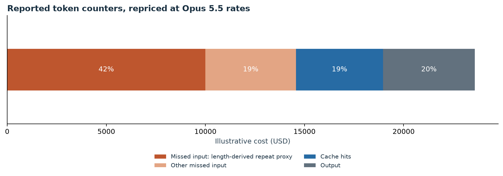
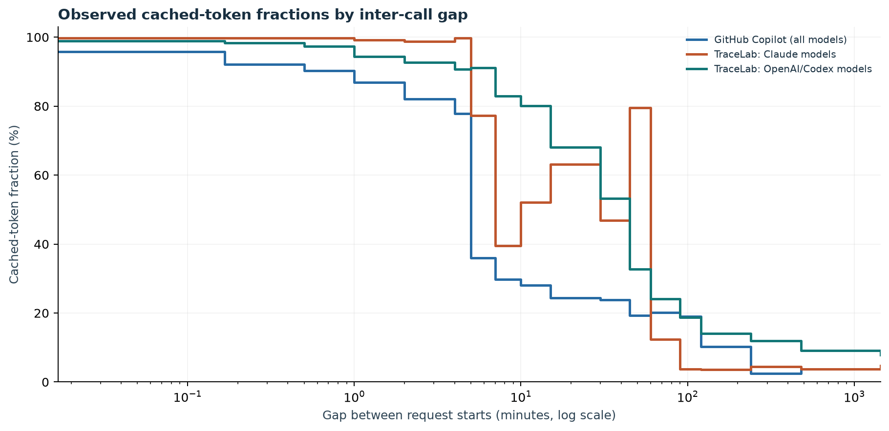
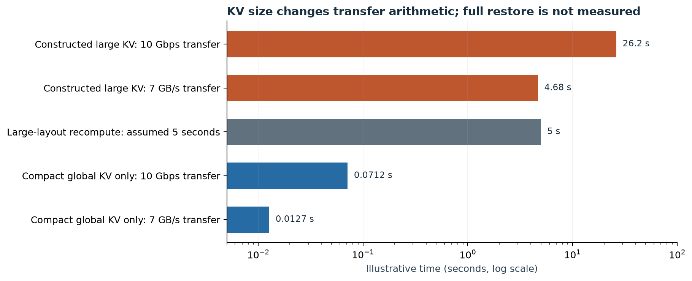
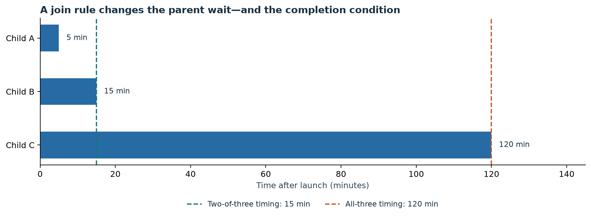
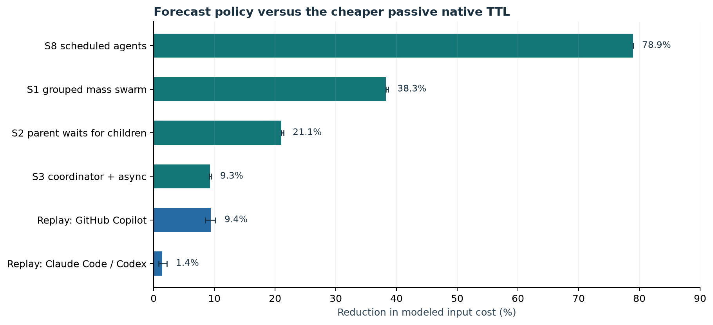
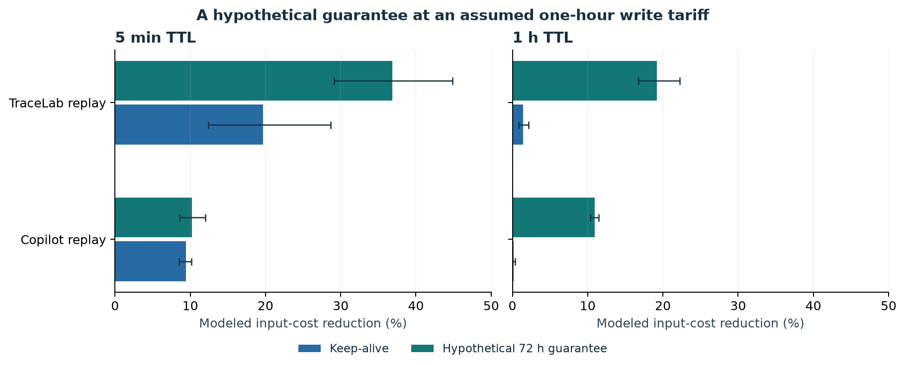
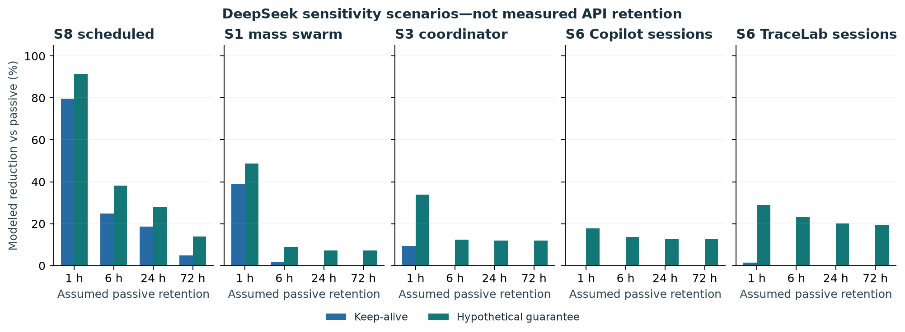

# The 88-Hour Cache Problem: KV Retention Economics for Agent Swarms

*Why long-running agents lose their cache, not their history—and when keeping it warm is worth paying for.*

An agent can save its conversation and send it again tomorrow. That preserves the history. It does not preserve the computation the provider already performed on that history.

When a prompt cache misses, the provider must process the prefix again. A swarm can therefore remember what happened while repeatedly paying to reconstruct the state needed to continue.

That is the distinction I wanted to investigate. The 88-hour research campaign in [OpenAI's Navier–Stokes announcement](https://openai.com/index/navier-stokes-solution/) supplied the motivating example. This is an exploratory simulation of workflow patterns, not a reconstruction of that campaign or its bill.

My argument is that cache economics depends on the shape of the waiting: a scheduled wake-up, a parent blocked on children and a human returning tomorrow present different retention decisions. Compact KV changes the provider's options. Workflow information may help decide where additional retention is worth paying for.

The [simulation repository](https://github.com/dineshdivi2/swarm-kv-economics) contains the v3 model, result snapshots, figure scripts and instructions for obtaining the public trace inputs. The percentages below are conditional model results, not measured savings from deploying a cache controller.

## 1. The bill behind the waiting

I took one day of GitHub Copilot's public coding-agent traces: 9,534 sessions and 344,134 calls. I repriced their reported token counters at Claude Opus 5.5 rates to illustrate the input-side economics. Copilot's actual models are anonymised; this is not its real invoice.

Under a scenario that prices every missed input token at the five-minute cache-write rate, misses account for about **62% of the illustrative $23.6K bill**. Output accounts for about 20%. Charging misses at the base input rate instead brings the total to $20.7K, with misses accounting for 56%.

The more tempting number needs care. A prompt-length calculation assigns about 69% of missed tokens to input beyond each session's initial prompt and positive prompt-length growth. If that inferred portion were an unchanged, reusable prefix and every such miss became a hit, the arithmetic difference would be about $9.6K at the write rate, or $7.6K at the base rate: roughly 41% or 37% of the respective bills.

**Prompt lengths cannot establish that those tokens are identical.** An agent can rewrite an earlier section while keeping the same length. The 69% is therefore a length-derived proxy, not a lower bound on repeated content. The 37–41% calculation is a conditional opportunity estimate, not measured avoidable waste or an attainable policy saving.

The defensible observation is simpler: input misses can dominate this illustrative bill. Whether a retention policy reduces that cost depends on exact prefix stability, timing and the price of maintaining it.

## 2. What the trace counters show

Across the Copilot extract and 8,041 TraceLab sessions, I examined 17,575 sessions containing 1,009,320 calls.

For adjacent calls using the same model, the calculation takes the smaller prompt length as a possible reusable-prefix length. It caps the next call's reported cached tokens at that length, then sums numerator and denominator within each request-start gap bin.

The patterns differ. The Claude-labelled TraceLab subset has very high cached-token fractions at short gaps and pronounced drops around the documented TTL boundaries. The OpenAI-labelled subset declines more gradually. Copilot's mixed-model stack has a lower cached-token fraction even in some short-gap bins.

These are **observed cached-token fractions, not identified probabilities that an exact prefix survives**. Prompt edits, routing, model selection, workload composition and cache expiry can all affect them. The data does not tell me how much sending an extra maintenance request would improve a later cache hit.

The simulator uses these curves as a restartable cache-retention law in one sensitivity analysis. That is an additional modeling assumption. It must not be confused with a measured keep-alive intervention.

## 3. Restoring KV can matter as much as storing it

Storage capacity is only part of the problem. A saved context must also become usable again within the available latency and bandwidth budget.

For a constructed Llama-70B-shaped FP16 layout, a 100K-token context occupies about 31 GiB. Moving that many bytes takes roughly 26 seconds over a 10 Gbps link, or 4.7 seconds at an assumed 7 GB/s local-storage rate. A five-second recompute time is included as an illustrative estimate, not a benchmark.

[DeepSeek's V4.1-Flash report](https://arxiv.org/abs/2609.19969) gives a global KV footprint of 890 bytes per token. At 100K tokens, that component is about 89 MB: roughly 71 ms of ideal transfer time over the same network link.

That comparison has a strict limit: **89 MB is the global KV component, not the complete state or an end-to-end restore measurement.** The report separately describes local sliding-window state and bounded replay. Queueing, allocation, deserialisation and replay can add latency. Different model architectures also have different recompute costs.

The report describes an internal lifetime of at least 72 hours for persistent global KV. Its [public API documentation](https://api-docs.deepseek.com/guides/kv_cache/) nevertheless describes caching as best effort. An internal deployment design is not a customer-facing retention guarantee.

Compact KV can make longer retention more practical. This does not establish the KV sizes of proprietary models, explain why their providers selected particular TTLs, or prove that a compact model can restore a complete context in under 100 ms.

## 4. Two possible retention arrangements

| Arrangement | What keeps the prefix reusable | What workflow information can help decide |
| --- | --- | --- |
| Short explicit TTL with client refresh | Compatible requests reuse the prefix before expiry | Which prefixes justify more reads, and when to stop |
| Longer provider-managed retention | The provider stores or reconstructs state under its own policy | Priority, readiness deadlines and whether a priced commitment is useful |

These arrangements are choices about architecture and policy; they are not fixed categories of model vendors.

When passive retention already handles almost every return, client hints may add little. They become more interesting when capacity is constrained, many agents wake together, or the client needs a readiness deadline rather than eventual availability. None of those readiness benefits is measured by the current simulator.

## 5. The break-even decision

Keeping a context warm costs maintenance reads. It is worthwhile only if the extra reuse they buy is worth more:

> **n × C_hit < q × (s_maintained − s_passive) × (C_miss − C_hit)**

Here, n is the number of maintenance reads, q is the probability of a compatible return, and s describes cache availability at that return under each policy.

This is simplified bookkeeping. The left side assumes hits, no generated output and no retries. Expected rebuild costs, output, failures and other maintenance overhead belong there too. The implemented simulator includes modeled rebuild costs; the short equation is an intuition, not a complete controller.

At the model's Opus 5.5 one-hour rates, reading a 100K-token prefix costs $0.02 and writing it costs $0.80. With a certain compatible return and an assumed survival uplift of 0.96, the simplified allowance is about 37 maintenance reads. At approximately hourly spacing, that is on the order of a day and a half. Using the five-minute write rate gives an allowance of about 23 reads, or roughly two hours of refreshes.

Those are conditional thresholds, not universal advice. A lower return probability or a smaller survival uplift reduces the allowance. Refreshes must arrive before expiry, with margin for request timing and failures.

For a best-effort cache the uplift is the unanswered question. At DeepSeek's peak rates used in this model, a 100K-token hit costs $0.0006 and the miss–hit difference is $0.0294. If maintenance raised survival from 80% to 95%, with a 50% chance of return, the simplified budget would be fewer than four reads. The survival improvement in that example is assumed, not measured.

## 6. Three kinds of waiting

### Scheduled agents

A scheduler knows when a nightly monitor should run again. In the synthetic mixture of hourly, four-hourly, daily and weekly agents, the forecast policy reduces modeled input cost by **78.9% relative to the cheaper passive native TTL**.

That is a result for the chosen mixture, not a claim about all scheduled agents. Some individual weekly waits sit beyond the model's refresh break-even. The model's hypothetical retention guarantee can help those waits; in a real system, shorter contexts, different scheduling or cheaper reconstruction are other options.

### A parent waiting for children

[Anthropic's multi-agent research-system account](https://www.anthropic.com/engineering/multi-agent-research-system) describes a lead agent waiting for synchronous sets of subagents, with a single slow child able to block progress.

The join rule changes the parent's wait:

A two-of-three quorum is useful only when two results are sufficient for the task. It changes the task's completion condition; it is not automatically a valid substitute for waiting for all three. The figure illustrates timing, not an evaluated quality-preserving optimisation.

In the synthetic parent–child family, the forecast policy reduces modeled input cost by **21.1% relative to the cheaper passive native TTL**. On the one-hour TTL alone, additional keep-alive saves 0% because the modeled waits already fit inside that window. Choosing the TTL matters before adding orchestration.

### An asynchronous coordinator

[Anthropic's Riemann-zeta account](https://www.anthropic.com/research/riemann-zeta) describes a long research effort coordinating about 60 subagents. That motivates a different pattern: agents launch, wait and return at uneven times.

The synthetic coordinator family reduces modeled input cost by **9.3% relative to the cheaper passive native TTL**. Much of its maintenance spend still falls on paths with no reusable prefix at return. Knowing that a branch has been cancelled or compacted can therefore be as useful as forecasting when it will wake.

These scenarios illustrate workflow shapes. They do not replay the internal execution traces of those published research systems.

## 7. What the simulator supports

“Best native TTL” means the cheaper of the modeled five-minute and one-hour passive policies for that workload. The forecast result likewise uses the cheaper forecast policy on those two TTLs. Percentages in this section compare **modeled input and maintenance cost**, not the entire application bill or provider operating cost.

The stored results show reductions of 78.9% for scheduled agents, 38.3% for the grouped mass swarm, 21.1% for parents waiting on children and 9.3% for asynchronous coordinators. These are synthetic scenarios with three-seed ranges, which do not measure uncertainty in the workload assumptions.

The public-session replays show **9.4% for Copilot** (90% bootstrap interval 8.5–10.2%) and **1.4% for TraceLab** (0.8–2.2%), each against its cheaper passive native TTL. Against the five-minute baseline specifically, the TraceLab result is 19.7% (12.4–28.7%). The denominator changes the conclusion.

There is also a material replay limitation: although the predictor is fitted on one half of the sessions and evaluated on the other, the replay labels wait type from the next call's initiator and treats next-model switches as known. Those features are not established as available at decision time. **These replay numbers are therefore not fully prospective evidence of a deployable policy.** The intervals condition on those labels, extraction choices and retention assumptions.

Three further results are useful as hypotheses:

1. **A long retention commitment can beat repeated refreshes under the assumed tariff.** At the one-hour TTL, the hypothetical 72-hour guarantee reduces modeled input cost by 11.0% for Copilot and 19.2% for TraceLab, compared with 0.18% and 1.43% for keep-alive. The guarantee is priced at the one-hour write tier. A different tariff could change the ranking.

    

2. **Keep-alive is unattractive under the selected lossy-curve assumptions.** When observed OpenAI- and Copilot-labelled cached-token fractions are treated as restartable retention probabilities, modeled rebuilds erase the benefit of refreshes. That is a result of this counterfactual model, not proof that keep-alive never pays on those providers.

3. **Indiscriminate refreshes can make the modeled bill worse.** Keeping every prefix warm for six hours after each call increases modeled input cost by about 61% on the Copilot replay and 109% in the synthetic tree-search scenario, relative to their five-minute passive baselines.

The code also contains a policy named `oracle`. It compares a restricted set of actions and is not a proven optimum: partial maintenance can beat it. I do not use it as an attainable upper bound here.

## 8. DeepSeek: retention changes the client's job

No live DeepSeek retention probe was run for this article. I instead examined assumed retention curves of roughly one, six, 24 and 72 hours, using the model's DeepSeek peak-rate snapshot.

Under the one-hour assumption, keep-alive has substantial modeled value in the scheduled and mass-swarm families. With longer assumed passive retention, that value falls sharply outside scheduled long waits. For scheduled agents, the additional reduction is about 25%, 19% and 5% across the six-, 24- and 72-hour assumptions.

These are sensitivity scenarios, not measurements of the public API. The guarantee panel also assumes only 1% loss within the guaranteed lifetime. It is an optimistic scenario under a chosen tariff, not an identified bound on real savings.

If untouched prefixes usually survive until return, a maintenance client may be unnecessary. The remaining question is whether priority or readiness commitments provide enough value to justify an interface and a price.

## 9. What I would try in a real system

- **Choose the native TTL first.** Compare actual bills for the available TTLs before adding refresh requests.
- **Measure exact prefix stability and intervention uplift.** Prompt lengths and natural-call hit counters cannot establish either one alone.
- **Use a compatible pre-warm request where supported.** [Anthropic documents `max_tokens: 0`](https://platform.claude.com/docs/en/build-with-claude/prompt-caching) for pre-warming without generating output. Its restrictions and thinking configuration still matter; a request rejected with thinking enabled is not proof that disabling thinking preserves the same cached prefix.
- **Stop when a prefix is no longer useful.** Pruning, cancellation, model changes and compaction can invalidate the reason for further maintenance.
- **Move status polling into tools and callbacks.** [OpenAI's Third Moment case study](https://openai.com/index/third-moment-research/) describes agents spending tokens on repeated completion checks while long backtests ran. A cache policy should not require repeatedly asking a model whether a job has finished.

API behaviour and prices can change. The provider documentation is the operational reference; the simulation is a dated set of assumptions.

## 10. The interface I want to test

Workflow-aware cache management already has prior art: [KVFlow](https://arxiv.org/abs/2507.07400), [prediction-based KV management](https://arxiv.org/abs/2605.06472) and [Continuum](https://arxiv.org/abs/2511.02230), alongside the Copilot study's keep-alive discussion. There are also lease or session-hint proposals in [llm-d](https://github.com/llm-d/llm-d-router/issues/2273) and [vLLM](https://github.com/vllm-project/vllm/issues/52113), and [session KV support in NVIDIA Dynamo](https://docs.nvidia.com/dynamo/v1.1.0/user-guides/agents).

The design question I want to explore is a portable, priced retention and readiness contract that makes the distinction between an advisory hint and a commitment explicit.

| Client signal | Meaning | Response the contract would need |
| --- | --- | --- |
| Return estimate | This prefix is likely to be needed within a time window | Accepted, clipped or ignored; identify the scope |
| Release | This branch no longer needs the prefix | Apply ownership rules for prefixes shared with other branches |
| Commitment request | Keep this prefix reusable or ready until a deadline, at a price | State expiry, latency, price and failure handling |

For example, the client might predict a return in 20–40 minutes and request readiness by minute 20. The provider could accept retention through minute 40 while declining the readiness deadline. That response would be more useful than silently treating a hint as a guarantee. This is a proposed contract, not an implemented API.

Stopping refreshes, releasing a session and deleting stored data remain different actions. The provider still decides whether to hold state in hot memory, use slower storage or reconstruct it.

## 11. The experiment that decides it

The question is falsifiable:

> **Does information observable at decision time improve cost or readiness beyond the best native TTL and a simple policy that stops maintaining known-dead contexts?**

The synthetic results make that worth testing for scheduled agents and blocked parents. The human-paced replays are less convincing, especially given their retrospective labels.

Two experiments remain unrun: matched untouched-versus-refreshed prefixes across different delays, and compatible pre-warming across thinking configurations. Both need actual billing counters, exact prefix identity, matched controls and repeated trials. Natural-call cached-token fractions cannot replace those experiments or validate a multi-step maintenance chain.

The outcome could narrow the proposal substantially. If passive retention is already generous and readiness adds little, the best client policy may be to send no extra requests. If observed workflow signals improve a controlled comparison, then a retention interface has a stronger case.

## Method, data and limits

- **Version:** publication edition based on simulator v3 and its supplied result snapshot. The full simulator was not independently rerun during publication polishing. The observed cached-token curves were checked against the supplied arrays in an earlier targeted audit; this is not a reconstruction from the raw upstream traces.
- **Public data:** [GitHub Copilot trace release](https://github.com/Azure/AzurePublicDataset/releases/tag/ghcp-coding-agent-2026), [Copilot study](https://arxiv.org/abs/2608.00101), [TraceLab release](https://github.com/uw-syfi/TraceLab/releases/tag/v0.0.2) and [TraceLab study](https://arxiv.org/abs/2606.30560). Obtain data under the upstream terms. The repository distributes extraction code and aggregate results, not the trace arrays.
- **Timing:** Copilot request start is inferred as timestamp minus duration. A targeted check still found ten overlapping adjacent calls; the interpretation is not verified upstream timing semantics. TraceLab uses the last input event as a request-start proxy.
- **Replay:** only S6 replays recorded coding-agent sessions. The other families are synthetic. Holdout fitting does not remove the future-label limitation described above. Terminal waits are handled through alternative assumptions, not proven abandonment labels.
- **Costs:** the bill illustration includes output; policy comparisons use modeled input and maintenance cost. Provider operations, application execution and task quality are outside that cost model. Historical prices are retained for reproducibility. [Opus prices](https://platform.claude.com/docs/en/build-with-claude/prompt-caching) and [DeepSeek peak prices](https://api-docs.deepseek.com/quick_start/pricing/) were cross-checked on 16 October 2026; DeepSeek also offers off-peak rates.
- **Uncertainty:** three synthetic seeds and 200 session-bootstrap resamples do not cover uncertainty in retention laws, workload design, feature availability or prices.
- **Not modeled:** restore contention, correlated wake bursts, progress-triggered replanning, exact content divergence and quality effects of changing join rules. The 72-hour guarantee and its tariff are hypothetical.
- **Reproduce and inspect:** [simulation README](https://github.com/dineshdivi2/swarm-kv-economics), [v3 tables](https://github.com/dineshdivi2/swarm-kv-economics/blob/main/results/v3-tables.md) and [figure data](https://github.com/dineshdivi2/swarm-kv-economics/blob/main/results/essay-figure-data.json). Source variable names and older generated findings may use stronger terminology; the limitations above qualify those labels.

*Views are my own.*
