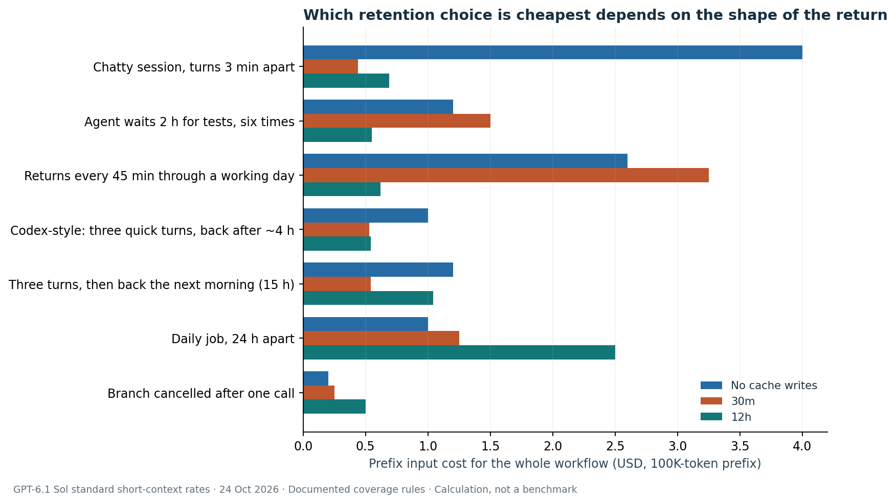
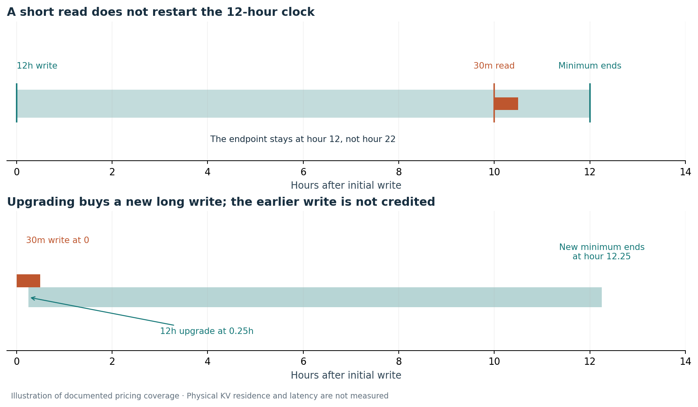

# 30 Minutes, 12 Hours, Forever: Decoding OpenAI's Three Cache Promises

*What each promise actually guarantees, what it reveals about the machinery underneath, and the two-return rule for when 12 hours pays.*

On 16 October I published [The 88-Hour Cache Problem](https://dineshdivi2.github.io/articles/001-agent-cache-economics/). It closed with the interface I wanted providers to offer: a "portable, priced retention and readiness contract." The client says when it expects to return; the provider says what it will commit to, and at what price.

On 20 October, OpenAI [shipped 12-hour prompt caching](https://developers.openai.com/api/docs/changelog#october-2026) in the Responses API, aimed at persistent agents that "reuse context throughout the day," with requests "hours apart."

Shortly after, Tibo Sottiaux of OpenAI's Codex team [went further](https://x.com/thsottiaux/status/2112712984644784534):

> "for logged in users across Codex & Work we keep cache forever and you don't have any penalty for coming back to an old conversation or resuming after a few hours and are now guaranteed to hit the cache."

Thirty minutes, twelve hours and forever: three cache promises from one company within a day. Read together, they show what OpenAI is selling, what it is absorbing, and what it must have built to do either.

## 1. The real change is one word

The headline is 12 hours. The more important change is the word in front of it.

The [prompt caching guide](https://developers.openai.com/api/docs/guides/prompt-caching#cache-lifetime) keeps both generations side by side:

| | Earlier models | GPT-5.6 and later |
| --- | --- | --- |
| Setting | `prompt_cache_retention`: `in_memory` or `24h` | `prompt_cache_options.ttl`: `30m` (default) or `12h` |
| Lifetime | "Typically 5 to 10 minutes" for `in_memory`; "up to 24 hours" for `24h` | "Minimum lifetime of 30 minutes or 12 hours" |
| Write charge | None | 1.25× input for `30m`, 2.5× for `12h` |
| Read charge | Model-dependent | 0.1× input; **0.05× on GPT-6.1 Sol** |

The old 24-hour option was a ceiling: the cache might survive a day, and usually lasted about half an hour. The new options are floors. For 12 hours after the write, OpenAI commits to billing a matching prefix as a cache read.

A best-effort maximum became a priced minimum. That is the move from hint to commitment that Article 001 argued for, now written into the documentation.

## 2. Three promises, one company

| Product | The promise | Price | Evidence |
| --- | --- | --- | --- |
| API, `30m` | Cached pricing for at least 30 min after the last use | Write 1.25×, read 0.05–0.1× | Documented |
| API, `12h` | Cached pricing for at least 12 h after the write | Write 2.5×, same read | Documented, 20 Oct |
| Codex & Work, logged in | "Keep cache forever", "guaranteed to hit", "no penalty" | Inside the subscription | Staff post; no documentation found |

The API documentation is careful exactly where the Codex post is bold:

- "Cache entries are not stored indefinitely."
- The cached KV tensors may be held in GPU-local storage "with a maximum retention period of 24 hours."
- The minimum lifetime "governs eligibility for cache-read pricing. It does not guarantee that every request reuses stored KV tensors or has lower latency."

So how does Codex keep a cache "forever"?

My read: **"forever" describes accounting, not storage.** In a subscription, a hit means the returning conversation is charged against your usage as a hit. Whether OpenAI kept the tensors, moved them to a cheaper tier or recomputed them is an implementation detail it has kept for itself.

That's the same design the API uses: commit to a price, keep freedom over the mechanism. The API sells that commitment by the hour; the subscription absorbs it to make long-running threads feel free.

## 3. What Article 001 proposed, and what arrived

| Proposed in Article 001 | Shipped on 20–21 October | Still missing |
| --- | --- | --- |
| Client states how long a prefix is useful | `ttl: "12h"`, settable per breakpoint | Arbitrary return windows; only two durations |
| Retention carries an explicit price | 2.5× write, published | — |
| Distinguish an advisory hint from a commitment | "Up to" became "at least" | — |
| Readiness by a deadline | Partial: `prewarm: true`, billed as a write | A latency or readiness commitment |
| Release a cancelled branch | — | "Manual cache clearing is not currently available" |
| One contract across providers | — | Each provider has its own interface |

Two arrived in full, two in part, two not at all. The missing rows all depend on what only the client knows: when a branch is dead, and when an answer is needed. That remains the next interface worth building.

## 4. What the docs reveal about the machinery

When a model processes a prompt, it builds key–value (KV) tensors: its internal working state for every token. Prompt caching keeps that state so a later request with the same opening, or prefix, can skip recomputing it.

The guide is unusually specific about where that state lives:

- "Cached states live on individual machines." A hit needs a request to reach "a machine holding a matching entry that has not expired."
- Routing uses a hash of the prompt's opening tokens plus an optional `prompt_cache_key`. Above "15 requests per minute," traffic "can lead to overflow routing" to machines without your entry.
- "OpenAI may retain entries longer than the requested minimum."

So the cache is machine-local state behind load-aware routing. A 12-hour promise means OpenAI either keeps that state reachable for 12 hours, or absorbs the cost of rebuilding it while still charging the read price.

This is part of a sequence. On 22 September OpenAI [launched](https://openai.com/index/better-prompt-caching-for-gpt-6/) "an improved prompt caching system" with GPT-6, along with cache diagnostics and reasoning-effort changes that don't break the cache. GitHub reported that Copilot had cut "by more than 50%" the share of prompt tokens requiring fresh processing. The 12-hour floor is the next step of the same programme.

**My inference, labelled as one.** Two documented facts are hard to explain with cheaper storage alone:

1. **The guaranteed lifetimes exist only on GPT-5.6 and later.** A pure storage upgrade could have reached older models too.
2. **Reads got cheaper on the newest model.** GPT-6.1 Sol charges 0.05× for a cached read, half the 0.1× on other new models.

Both fit models whose KV state is smaller and cheaper to keep or restore. DeepSeek has [published one way to do that](https://arxiv.org/abs/2609.19969): cross-layer KV reuse and 4-bit KV storage bring its global KV component to 890 bytes per token. That's about 89 MB for a 100K-token context, against roughly 31 GB for a classic 70B-class FP16 layout. DeepSeek also keeps that state internally for at least 72 hours.

I expect OpenAI has done something comparable, co-designing the model and the serving stack so that a day of agent context is cheap enough to sell. OpenAI hasn't said so, and prices can't reveal its storage bill. But "longer and cheaper, only on new models" is the signature you'd expect if the efficiency came from the architecture.

## 5. When the 12-hour write pays

A 2.5× write is a bet on coming back. I priced seven agent workflows for one unchanged 100K-token prefix at GPT-6.1 Sol's [standard rates](https://developers.openai.com/api/docs/pricing). Per million tokens, those are $2 input, $2.50 for a `30m` write, $5 for a `12h` write and $0.10 for a read. The model applies the documented refresh rules and assumes no reuse beyond each guaranteed minimum.

| Workflow | Uses | No cache | `30m` | `12h` | Cheapest |
| --- | ---: | ---: | ---: | ---: | --- |
| Chatty session, turns 3 min apart | 20 | $4.00 | **$0.44** | $0.69 | `30m` |
| Agent waits 2 h for tests, six times | 6 | $1.20 | $1.50 | **$0.55** | `12h` |
| Returns every 45 min through a working day | 13 | $2.60 | $3.25 | **$0.62** | `12h` |
| Codex-style: three quick turns, back after ~4 h | 5 | $1.00 | **$0.53** | $0.54 | tie |
| Three turns, back the next morning (15 h) | 6 | $1.20 | **$0.54** | $1.04 | `30m` |
| Daily job, 24 h apart | 5 | **$1.00** | $1.25 | $2.50 | no cache |
| Branch cancelled after one call | 1 | **$0.20** | $0.25 | $0.50 | no cache |

No option dominates; the shape of the waiting decides. It reduces to one rule:

> **The two-return rule: buy `12h` when you expect at least two returns after a pause of more than 30 minutes, all within 12 hours of the write.**

The arithmetic: choosing `12h` over `30m` costs an extra 1.25× of the prefix up front. Under `30m`, each return after a long pause pays a fresh 1.25× write instead of a 0.05× read, so 1.2× more. One long return almost pays back the difference; two clearly do. A gap beyond 12 hours defeats both.

Against no caching at all, the `12h` write pays once expected reuse exceeds about 1.6: precisely (2.5 − 1) / (1 − 0.05) = 1.58 on Sol, and 1.67 at the usual 0.1× read.

The Codex-style row is the telling one. Resuming after a few hours is roughly break-even on the API. Inside Codex, Tibo says it now carries no penalty at all.

## 6. Twelve hours is not a rolling lease

Two documented rules surprise anyone picturing a self-renewing 12-hour lease:

- A `30m` read on a `12h` entry "preserves the later of the existing expiry and 30 minutes after the read. It does not restart a 12-hour clock."
- "Upgrading valid 30-minute coverage to 12 hours charges a new 12-hour write for those tokens, without credit for the earlier write."

One gap: the guide doesn't say whether a `12h` read restarts the 12-hour clock. None of the scenarios above depend on it, but a multi-day agent would. It's the first thing I'd ask OpenAI to document.

## 7. The next miss is self-inflicted

With long pauses covered, the remaining misses come from the application. Reuse "requires the entire rendered prefix to match." Reordering tools, editing an early message or compacting the conversation breaks it, however long the lifetime you bought.

OpenAI's guidance points the same way:
- Keep tool definitions stable. Use `allowed_tools` or `tool_choice: none` instead of removing tools.
- Append new instructions near the end instead of rewriting the start.
- Use the [cache diagnostics](https://developers.openai.com/api/docs/guides/prompt-caching/diagnostics), which return reasons such as `tools_changed`.

The client's question has moved. In Article 001 it was *when to refresh*; now it's *how not to change the prefix*. Some of the keep-alive machinery I simulated last time is simply no longer needed, which is the right outcome.

## 8. What I'll test next

- **Bills, not counters.** Run the seven workflows on the live API with `30m`, `12h` and a mix (`12h` on stable instructions, `30m` on the evolving tail). Record billed writes, cached tokens and time to first token.
- **The refresh question.** Does a `12h` read extend the clock? Two requests 13 hours apart will answer it.
- **Codex "forever".** Resume a large Codex thread after 1, 4 and 24 hours and compare usage.
- **Change versus expiry.** In a real agent loop, measure what share of misses come from prefix changes rather than waiting.

None of these have been run yet; the table is arithmetic on documented prices and rules. If you've measured any of this, I'd like to compare notes.

## Sources and scope

Documentation, prices and posts were checked on 24 October 2026:
- [Prompt caching guide](https://developers.openai.com/api/docs/guides/prompt-caching)
- [API pricing](https://developers.openai.com/api/docs/pricing)
- [Changelog, October 2026](https://developers.openai.com/api/docs/changelog#october-2026)
- [Better prompt caching for GPT-6](https://openai.com/index/better-prompt-caching-for-gpt-6/), 22 September
- [Tibo Sottiaux's Day 16 post](https://x.com/thsottiaux/status/2112712984644784534)
- [DeepSeek V4.1-Flash report](https://arxiv.org/abs/2609.19969)

Prices are GPT-6.1 Sol standard short-context rates (up to 272K input tokens). Costs cover the reused prefix only: no output, new input, tools or retries. Section 4's reading of OpenAI's architecture is my inference; OpenAI has not published it. The Codex & Work claim is a staff post, not documentation. The [calculation inputs](analysis/inputs.json) and [scenario costs](analysis/costs.csv) are published alongside this article.

*Views are my own.*
